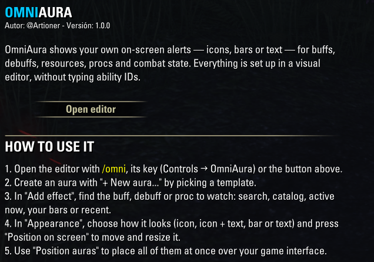

# OmniAura

*[English](README.md) · Español*



**Tus propios avisos en pantalla para The Elder Scrolls Online.** Vigila buffs, debuffs, recursos, procs de sets y el estado de combate, y muéstralos como iconos, barras o textos justo donde quieras, todo desde un editor visual dentro del juego y sin escribir ni un solo ID.

Versión actual: **1.0.0** (ver [CHANGELOG.md](CHANGELOG.md)).

## Uso

- `/omni` abre y cierra el editor. También desde *Ajustes → Add-Ons → OmniAura* o con una tecla en *Controles → OmniAura*.
- **+ Nueva aura...** crea un aura a partir de una plantilla.
- En las auras de buff y proc, los efectos se eligen con el buscador, el **catálogo** o los atajos (efectos actuales, habilidades de tus barras, recientes). Un aura con varios efectos se muestra si hay *cualquiera* de ellos.
- El botón **Ubicar en pantalla** (al final de Apariencia) cierra el editor y muestra el aura que editas sobre la interfaz de juego: se arrastra para moverla, su esquina amarilla cambia el tamaño y «Listo» vuelve al editor.
- **Ubicar auras** (debajo de la lista) oculta el editor y muestra la interfaz de juego normal para colocar todas las auras a la vez; se termina con «Listo» o Esc.
- La flecha junto a la X pliega el editor. Mientras está abierto, las auras activas no se muestran.

### Comandos de chat (avanzado)

```
/omni                    abre/cierra el editor
/omni list               lista las auras numeradas
/omni show|on|off|del|copy <n>
/omni set <n> <ruta> <valor>   p. ej. set 1 display.type bar
/omni scan [player|target]     efectos actuales con su ID
/omni log                registra los IDs de las habilidades que usas
/omni unlock | lock      entrar/salir del modo «Ubicar auras»
/omni reset confirm      borra todas las auras
```

## Desarrollo

Enlaza la carpeta del proyecto en la de AddOns del juego (PowerShell):

```powershell
New-Item -ItemType Junction `
  -Path "$env:USERPROFILE\Documents\Elder Scrolls Online\live\AddOns\OmniAura" `
  -Target "D:\Projects\ESO Addons\OmniAura"
```

- Cambios en archivos `.lua` existentes: `/reloadui`.
- Archivos nuevos o cambios en `OmniAura.txt`: hay que **cerrar el juego del todo** y volver a abrirlo.
- Errores: con LibDebugLogger instalado quedan en `SavedVariables/LibDebugLogger.lua`.

### Estructura

```
OmniAura.txt            manifiesto
OmniAura.lua            namespace, SavedVariables, arranque, bienvenida
lang/*.lua              textos (en = base; es, de, fr sobrescriben)
Core/Utils.lua          parseo, rutas, formato de tiempo, plantillas de texto
Core/Triggers.lua       tipos de trigger (buff, resource, proc, combat)
Core/Recent.lua         efectos/habilidades vistos recientemente
Core/AbilityIndex.lua   índice de todas las habilidades del juego (búsqueda y catálogo)
Core/Engine.lua         evaluación de auras cada 100 ms; alta/copia/borrado
Core/Commands.lua       comandos /omni
Display/Displays.lua    tipos de display (icon, icontext, bar, text), mover y redimensionar
Editor/Editor.lua       ventana del editor (formulario generado desde esquemas)
Editor/Catalog.lua      ventana del catálogo de habilidades
Editor/Settings.lua     panel de LibAddonMenu, donaciones, bienvenida/novedades
Bindings.xml            tecla para abrir el editor
```

- **Trigger nuevo:** `OA.Triggers.types.<nombre> = { Prepare, Register, Unregister, Check }` y sus campos en `TRIGGER_FIELDS` del editor.
- **Display nuevo:** `NewType("<nombre>")` con `Build`, `Configure`, `Update` y `SetBoxSize`, y sus campos en `DISPLAY_FIELDS`.
- **Opción del formulario:** una línea en el esquema; `show = function(ctx)` la oculta cuando no aplica.

### Publicar una versión

1. Subir `OA.version` en `OmniAura.lua` y `## Version` / `## AddOnVersion` en `OmniAura.txt`.
2. Actualizar `L.CHANGELOG` en los cuatro `lang/*.lua` (es lo que ve el jugador al actualizar) y `CHANGELOG.md`.
3. Revisar `## APIVersion` (en el juego: `/script d(GetAPIVersion())`).
4. Empaquetar la carpeta `OmniAura/` en un zip (el zip debe contener la carpeta, no los archivos sueltos).

## Licencia

[MIT](LICENSE) © @Artioner
